<p align="center">
  
</p>

# 🚀 Awesome OS Customization: The Ultimate Curated Ecosystem

<p align="center">
  <a href="https://github.com/ishandutta2007/Awesome-Awesome-Awesome"></a>
  <a href="https://discord.gg/jc4xtF58Ve"></a>
  <a href="https://github.com/ishandutta2007/Awesome-OS-Customization/stargazers"></a>
  <a href="https://github.com/ishandutta2007/Awesome-OS-Customization/network/members"></a>
  <a href="https://github.com/ishandutta2007/Awesome-OS-Customization/blob/main/LICENSE"></a>
  <a href="https://github.com/ishandutta2007/Awesome-OS-Customization/pulls"></a>
  <a href="https://github.com/ishandutta2007"></a>
</p>

---

## 📖 Introduction & SEO Overview

Welcome to the definitive index of **OS Customization**, **Windows Debloating**, **Image Slipstreaming**, **System Optimization**, and **Bootable Media Creation** tools. 

Whether you are an IT enterprise systems administrator seeking automated unattended deployments across thousands of endpoints, a software developer looking to strip telemetry and bloatware for high-throughput build workstations, or a gaming enthusiast crafting a lightweight custom Windows 11 ISO, this repository indexes the most reliable commercial platforms and verified open-source utilities.

### 🔍 Key Areas of Focus
* 💿 **ISO Image Slipstreaming & Servicing**: Pre-configure unattended answer files (`autounattend.xml`), integrate cumulative servicing patches, inject storage/network drivers (NVMe/RAID), and strip legacy components prior to initial system boot.
* 🧹 **Bloatware & Telemetry Stripping**: Safely uninstall provisioned AppX/MSIX packages, disable diagnostics tracking (DiagTrack, Cortana, Copilot, Edge web widget), and silence advertising IDs.
* ⚙️ **Performance Tuning & System Tweaks**: Reconfigure MMCSS gaming priorities, TCP/IP network stack tuning, context menu restorations, Windows Explorer enhancements, and background service optimization.
* 🚀 **Multi-Boot & Installation Media**: Create UEFI/BIOS compatible flash drives, multi-ISO bootable disks, and automated live test environments.

---

## 📑 Table of Contents
- [📊 Sector Overview \& Market Dynamics](#-sector-overview--market-dynamics)
- [🏢 Commercial \& SaaS Deployment Platforms](#-commercial--saas-deployment-platforms)
- [💻 Open-Source GitHub Projects](#-open-source-github-projects)
- [🧰 Notable Freeware \& Community Utilities](#-notable-freeware--community-utilities)
- [🏗️ Recommended Architecture \& Workflows](#️-recommended-architecture--workflows)
- [🤝 How to Contribute](#-how-to-contribute)
- [⚠️ Security \& Safety Disclaimer](#️-security--safety-disclaimer)
- [💖 Support \& Sponsoring](#-support--sponsoring)
- [##  Star History](#--star-history)

---

## 📊 Sector Overview & Market Dynamics

The global operating system optimization, automated provisioning, and endpoint deployment software market is currently estimated at approximately **$2.2 Billion**, projected to expand at a compound annual growth rate (CAGR) of **6.8%** through 2030. 

Market dynamics demonstrate a clear structural divide:
* **Enterprise OS Deployment & Provisioning Tier**: **Moderately concentrated** among major IT endpoint management and disk imaging vendors (e.g., Zoho ManageEngine, PDQ/SmartDeploy, Acronis, and Microsoft Intune). These vendors monetize centralized fleet compliance, hardware-independent HAL deployment, and enterprise driver databases.
* **Consumer, Power-User & Enthusiast Customization Tier**: **Highly fragmented** with dynamic community-driven competition. Rather than a winner-take-all monopoly, power users, gamers, and developers actively migrate between modular PowerShell debloating scripts, DISM GUIs, and ISO slimming engines based on OS build compatibility (such as Windows 11 24H2/25H2/26H2 releases) and transparency.

---

## 🏢 Commercial & SaaS Deployment Platforms

The following commercial SaaS and enterprise-grade software suites provide centralized OS deployment, image provisioning, system optimization, and pre-boot configuration. The table is ordered by **Company Size / Valuation / Revenue** (descending).

| Platform / Product | Primary OS Customization Focus | Company Size / Valuation / Revenue | Pricing (Specific Starting Tier) | Free Tier Limits & Free Trial Details |
| :--- | :--- | :--- | :--- | :--- |
| **[ManageEngine OS Deployer](https://www.manageengine.com/products/os-deployer/)** | Centralized disk imaging, automated OS deployment, hardware-independent driver management, and bare-metal provisioning across corporate networks. | **Zoho Corporation**: ~$1.1B+ Annual Revenue \| ~$10B+ Est. Valuation (15,000+ employees globally) | **$125.00/year** (Professional Edition, starting tier managing up to 50 workstations) | **Free Edition forever** supporting up to 4 workstations and 1 server with basic imaging capabilities; also includes a 30-day unrestricted trial for all enterprise features. |
| **[Acronis Snap Deploy](https://www.acronis.com/en-us/products/snap-deploy/)** | Rapid mass OS provisioning, golden image replication, bare-metal deployment to multiple live machines simultaneously via multicast, and custom post-configuration. | **Acronis**: ~$3.5 Billion Valuation \| ~$350M+ Annual Revenue (Backed by EQT Partners) | **$33.00 per machine** (One-time deployment license) or **$85.00/machine/year** (Unlimited deployment license) | **30-day full-featured free trial** limited to 5 machine deployments for deployment verification and lab testing. |
| **[SmartDeploy](https://www.smartdeploy.com/)** | Cloud-managed and local Windows golden image management, driver slipstreaming via pre-built Platform Packs, application layering, and zero-touch remote provisioning. | **PDQ / TA Associates**: ~$500M+ Valuation \| ~$75M+ Annual Revenue | **$1,180.00/year** (Starting tier at $11.80 per computer/year with a minimum purchase of 100 computers) | **15-day full-featured free trial** supporting deployment tests on up to 15 managed physical or virtual endpoints. |
| **[IObit Advanced SystemCare PRO](https://www.iobit.com/en/advancedsystemcarepro.php)** | Automated system performance tuning, deep registry cleaning, junk file wiping, startup speedup, and background telemetry suppression. | **IObit**: ~$30M+ Annual Revenue (Over 50M+ consumer downloads worldwide) | **$19.99/year** (PRO license valid for up to 3 PCs) | **Free-forever Basic Edition** with standard junk cleaning and PC optimization; locks automated background RAM cleaning, deep registry defragmentation, and scheduled real-time optimizations. |
| **[Ashampoo WinOptimizer](https://www.ashampoo.com/en-us/winoptimizer)** | Comprehensive Windows system tweaker, privacy manager, context menu customizer, telemetry blocker, and disk cleaning suite. | **Ashampoo GmbH & Co. KG**: ~$25M+ Annual Revenue (Over 20M+ registered users) | **$30.00/year** (WinOptimizer 27 full license for up to 3 PCs) | **30-day free trial** (10 days initial unrestricted trial + 20 additional days granted upon free email activation); alongside a permanent **WinOptimizer Free** version with baseline cleaning. |
| **[NTLite](https://www.ntlite.com/)** | The premier Windows ISO slipstreaming, unattended setup, driver integration, update injection, and component-stripping pre-installation suite. | **Nlite Software**: ~$2M+ Annual Revenue (Independent developer Dino Nuhagic / boutique utility firm) | **€40.00 (~$43.00)** one-time purchase (Home License for 1 PC, including 1 full year of continuous updates) | **Free-forever Edition** for non-commercial personal use featuring basic component removal, driver/update slipstreaming, and unattended setup; restricts advanced component removal, live OS tweaking, and deep system cleaning. |

---

## 💻 Open-Source GitHub Projects

Below is the verified collection of active, open-source projects for Windows debloating, ISO slimming, system optimization, and bootable media creation. 

The list is sorted in **descending order by GitHub Star Count**. Beside each project name is a social white star badge linking directly to that repository's stargazers page.

---

### 1. [Ventoy](https://github.com/ventoy/Ventoy) <a href="https://github.com/ventoy/Ventoy/stargazers"></a>
* **Core Functionality**: The revolutionary open-source multi-boot USB solution.
* **Key Features**: 
  * Eliminates the need to repeatedly reformat USB drives when changing OS installers.
  * Simply drag and drop ISO, WIM, IMG, VHD(x), and EFI files directly onto the drive partition.
  * Features an interactive boot menu capable of parsing over 1,300+ verified images (Windows 11/10/7, WinPE, Linux distributions, ChromeOS, Unix).
  * Native support for UEFI Secure Boot, MBR/GPT partition tables, Linux persistence plugins, and automated unattended script injection.
* **Best For**: Systems engineers, technicians, and power users who need a single thumb drive carrying rescue environments, live Linux tools, and custom Windows setup ISOs.

---

### 2. [Chris Titus Tech's Windows Utility (WinUtil)](https://github.com/ChrisTitusTech/winutil) <a href="https://github.com/ChrisTitusTech/winutil/stargazers"></a>
* **Core Functionality**: Community-standard all-in-one PowerShell GUI utility for Windows maintenance, debloating, application installation, and tweaks.
* **Key Features**:
  * One-line PowerShell launch: `irm "https://christitus.com/win" | iex`.
  * Installs curated programs via Winget and Chocolatey with automated silent batch scripts.
  * Curated system tweaks: disables telemetry, removes OneDrive, turns off Cortana, configures services to manual, and applies dark theme presets.
  * Includes the "MicroWin" feature to generate stripped-down Windows installation ISOs with reduced memory footprint and bypassed hardware checks.
* **Best For**: Quick post-install setups and ongoing system maintenance without manual Registry hunting.

---

### 3. [Win11Debloat](https://github.com/Raphire/Win11Debloat) <a href="https://github.com/Raphire/Win11Debloat/stargazers"></a>
* **Core Functionality**: Lightweight, modular PowerShell script for debloating and decluttering Windows 11 and Windows 10.
* **Key Features**:
  * Quick, transparent, and auditable removal of pre-installed Microsoft bloatware apps (Clipchamp, News, Weather, Xbox telemetry, Solitaire).
  * Disables diagnostics, telemetry, tailored experiences, advertising IDs, and intrusive Edge desktop widgets.
  * Restores classic right-click context menus in Windows 11, aligns taskbar buttons, and turns off search highlights.
  * Interactive CLI menu or silent scripted deployment mode (`-RunDefaults`, `-RemoveApps`, `-DisableTelemetry`).
* **Best For**: Users who want a zero-dependency, auditable PowerShell script to clean a fresh or existing Windows installation.

---

### 4. [Rufus](https://github.com/pbatard/rufus) <a href="https://github.com/pbatard/rufus/stargazers"></a>
* **Core Functionality**: The definitive high-performance bootable USB drive creator for Windows, Linux, and UEFI.
* **Key Features**:
  * Incredibly fast writing speed compared to competitors, with automated bad-block checking.
  * Windows User Experience (WUE) customization dialog: automatically creates a local offline account, bypasses Windows 11 TPM 2.0 / Secure Boot / RAM hardware requirements, and disables BitLocker auto-encryption.
  * Toggles to automatically bypass online Microsoft Account (MSA) mandates and disable data collection questions during setup.
  * Portable standalone executable (~1.9 MB) licensed under GPLv3.
* **Best For**: Flashing clean Windows ISOs directly to flash media with pre-baked installation bypasses.

---

### 5. [AtlasOS](https://github.com/Atlas-OS/Atlas) <a href="https://github.com/Atlas-OS/Atlas/stargazers"></a>
* **Core Functionality**: An open-source, transparent modification framework for Windows designed to optimize latency, performance, and privacy.
* **Key Features**:
  * Uses the standardized AME Wizard playbook system to safely modify an official Windows install without redistributing pre-built untrusted ISOs.
  * Strips heavyweight background services, reduces process counts from 180+ down to under 60 on a clean idle system.
  * Disables Windows tracking, consumer telemetry, and background services while maintaining full compatibility with modern anti-cheat systems (Valorant Vanguard, Easy Anti-Cheat, BattlEye).
  * Modular toggles for Bluetooth, printing, sleep states, and Windows Update.
* **Best For**: Gamers, streamers, and audio/video production engineers demanding minimized DPC latency and maximum framerate consistency.

---

### 6. [Tiny11 Builder](https://github.com/ntdevlabs/tiny11builder) <a href="https://github.com/ntdevlabs/tiny11builder/stargazers"></a>
* **Core Functionality**: Open-source utility and scripts to build lean, lightweight Windows 11 ISOs from official Microsoft media.
* **Key Features**:
  * Modernized with a dedicated WinUI 3 graphical interface alongside PowerShell automation backends.
  * Multiple build profiles: **Tiny11** (removes default bloatware apps while maintaining Windows Update, Defender, and servicing viability), **Tiny11 Core** (stripped down for VM testing and lab environments), and **Custom** mode.
  * Supports the latest Windows 11 builds (including 24H2, 25H2, and 26H2 servicing branches).
  * Automatically injects bypasses for hardware restrictions and eliminates forced online account creation during OOBE.
* **Best For**: Creating customized, lean Windows 11 ISO files for low-resource hardware, virtual machines, or streamlined deployments.

---

### 7. [Dism++](https://github.com/Chuyu-Team/Dism-Multi-language) <a href="https://github.com/Chuyu-Team/Dism-Multi-language/stargazers"></a>
* **Core Functionality**: Powerful graphical frontend and enhancement suite for Microsoft Deployment Image Servicing and Management (DISM).
* **Key Features**:
  * Mounts, inspects, and edits WIM, ESD, and VHD images without touching the command line.
  * Performs deep system cleanup (WinSxS folder compression, driver store cleanup, obsolete update uninstallation).
  * Driver management: backup existing system drivers, slipstream new INF driver packages into offline installation images.
  * Comprehensive OS tweak toolbox covering Windows Explorer, system services, update settings, and startup applications.
* **Best For**: Advanced users and technicians who need portable, deep image servicing and cleanup without enterprise licensing fees.

---

### 8. [Windows10Debloater](https://github.com/Sycnex/Windows10Debloater) <a href="https://github.com/Sycnex/Windows10Debloater/stargazers"></a>
* **Core Functionality**: The pioneering open-source PowerShell script that defined Windows bloatware removal.
* **Key Features**:
  * Provides both an interactive GUI and silent CLI execution parameters.
  * Uninstalls bundled UWP/AppX applications (Candy Crush, Xbox Game Bar, 3D Builder, Groove Music).
  * Reverts intrusive registry modifications, stops telemetry services, disables Cortana, and unpins Start Menu bloat tiles.
  * Option to selectively remove OneDrive or retain it based on user preference.
* **Best For**: Windows 10 installations and classic reference architectures for automated enterprise deployment scripts.

---

### 9. [Optimizer](https://github.com/hellzerg/optimizer) <a href="https://github.com/hellzerg/optimizer/stargazers"></a>
* **Core Functionality**: Advanced, portable C# utility designed to enhance privacy, security, and performance across Windows 7, 8, 10, and 11.
* **Key Features**:
  * Disables Windows telemetry, Cortana, sensor services, SmartScreen, and diagnostic logging with single-click toggles.
  * Performance tweaks: disable HPET, optimize TCP/IP parameters, disable hibernation, and increase system responsiveness.
  * Windows 11 specific fixes: restore classic taskbar size, disable Copilot, restore classic File Explorer ribbon, and remove Recommended section.
  * Built-in host file editor, startup item manager, hardware benchmark viewer, and Winget package installer.
* **Best For**: Power users wanting a feature-rich, portable executable for comprehensive system tuning on live installations.

---

### 10. [Winhance](https://github.com/memstechtips/Winhance) <a href="https://github.com/memstechtips/Winhance/stargazers"></a>
* **Core Functionality**: Modern open-source Windows 10 and 11 optimization application built with a native WinUI 3 interface.
* **Key Features**:
  * Automatically creates a System Restore Point before applying any system or registry modifications.
  * Comprehensive bloatware remover supporting batch uninstallation of default Microsoft and OEM apps.
  * Generates custom `autounattend.xml` answer files for unattended, automated Windows setup across multiple computers.
  * UI tweaks, context menu restorations, telemetry disablers, and performance tuning toggles.
* **Best For**: Users who appreciate a clean, modern Windows 11 native aesthetic combined with robust fail-safe restore mechanisms.

---

### 11. [Sophia Script for Windows](https://github.com/farag2/Sophia-Script-for-Windows) <a href="https://github.com/farag2/Sophia-Script-for-Windows/stargazers"></a>
* **Core Functionality**: The most powerful, granular PowerShell module for fine-tuning and automating Windows 10 and 11 on GitHub.
* **Key Features**:
  * Over 150+ granular functions covering privacy, telemetry, UI, storage, security, and scheduled tasks.
  * Accompanied by "SophiApp", a modern WPF/C# GUI frontend for interactive configuration.
  * Accurately cleans up Windows components, disables diagnostic tracking, and configures Windows Defender attack surface reduction (ASR) rules.
  * Full support for running via enterprise deployment systems or standalone PowerShell execution.
* **Best For**: Enterprise administrators and advanced enthusiasts seeking surgical, code-level control over every Windows subsystem.

---

### 12. [Win-Debloat-Tools](https://github.com/LeDragoX/Win-Debloat-Tools) <a href="https://github.com/LeDragoX/Win-Debloat-Tools/stargazers"></a>
* **Core Functionality**: Re-imagines Windows as a minimal, lightweight operating system install with minimal impact on essential services.
* **Key Features**:
  * Safe and thorough debloating presets designed never to break Windows Update, Microsoft Store, or gaming Xbox services.
  * Quick-config scripts to disable telemetry, clean up scheduled tasks, and remove tracking services.
  * Includes Winget integration for automated software installation and selective driver servicing.
* **Best For**: Users seeking a balanced debloater that maximizes privacy without breaking core operating system features.

---

### 13. [Bloatynosy](https://github.com/builtbybel/Bloatynosy) <a href="https://github.com/builtbybel/Bloatynosy/stargazers"></a>
* **Core Functionality**: Intuitive Windows 11 debloater and setup assistant (formerly known as ThisIsWin11 / Bloatynosy / JunkCtrl).
* **Key Features**:
  * Analyzes your fresh Windows install and provides targeted recommendations on what bloatware to remove.
  * Custom packages ("InstaPackage") for installing open-source productivity apps in bulk.
  * Disables Copilot, Bing Search integration in the Start menu, advertising IDs, and lock screen widgets.
  * Lightweight, portable, and open-source.
* **Best For**: Casual users who want step-by-step guidance on which Windows 11 annoyances to eliminate.

---

### 14. [ReviOS Playbook](https://github.com/meetrevision/playbook) <a href="https://github.com/meetrevision/playbook/stargazers"></a>
* **Core Functionality**: Lightweight, stable, performance-focused modification playbook for Windows 10 and 11.
* **Key Features**:
  * Operates via the AME Wizard framework, ensuring your starting base is an authentic Microsoft ISO or deployment.
  * Optimizes system latency, removes redundant background services, and eliminates telemetry while preserving OS stability.
  * Includes the Revision Tool, a dedicated utility for managing Windows Update toggles, Defender states, and performance features.
* **Best For**: Gamers and creative professionals looking for a tested, repeatable operating system baseline with minimal background interference.

---

### 15. [Optimizer-W11](https://github.com/Simv135/Optimizer-W11) <a href="https://github.com/Simv135/Optimizer-W11/stargazers"></a>
* **Core Functionality**: Dedicated Windows 11 system optimizer with automatic restore point creation and gaming priority adjustments.
* **Key Features**:
  * Automatically creates a System Restore Point prior to applying any system alterations.
  * Adjusts multimedia network throttling (MMCSS), DirectX parameters, and USB polling latency.
  * Disables telemetry services, removes Cortana, and turns off telemetry-heavy scheduled tasks.
* **Best For**: Targeted Windows 11 gaming optimization with built-in rollback safeguards.

---

### 16. [Windows-Optimizer](https://github.com/NishantJLU/Windows-Optimizer) <a href="https://github.com/NishantJLU/Windows-Optimizer/stargazers"></a>
* **Core Functionality**: Safety-first modular Windows optimization utility featuring data-driven JSON configurations and automatic registry exports.
* **Key Features**:
  * Automatically creates a System Restore Point and exports a standalone `.reg` backup before every individual modification.
  * Features a dedicated "Restore Center" allowing users to cleanly reverse specific changes.
  * User profile presets: Gamer, Developer (installs Git, Docker, Python via Winget), Minimalist, and Manual.
* **Best For**: Users who require 100% reversible tweaks with per-modification backup tracking.

---

## 🧰 Notable Freeware & Community Utilities

While not hosted as open-source code repositories on GitHub, the following tools and communities represent indispensable industry standards:

* **[Winaero Tweaker](https://winaero.com/)**: The comprehensive freeware system customization encyclopedia by Sergey Tkachenko. Supports granular tweaks for Windows 11 taskbar coloring, classic Explorer menus, context menu management, font scaling, and lock screen configurations.
* **[MSFN Forums](https://msfn.org/)**: The premier long-running community dedicated to unattended Windows installations, INF driver modification, nLite/NTLite slipstreaming scripts, and operating system preservation.

---

## 🏗️ Recommended Architecture & Workflows

To build a reliable, auditable, and performance-optimized Windows workstation or deployment environment, avoid downloading untrusted pre-modified ISOs (e.g., Ghost Spectre) from unknown sources. Instead, construct your custom stack using auditable tools:

```
┌────────────────────────────────────────────────────────┐
│            1. Base Official Microsoft ISO              │
│       (Official Media Creation Tool or VLSC ISO)       │
└───────────────────────────┬────────────────────────────┘
                            │
                            ▼
┌────────────────────────────────────────────────────────┐
│             2. Pre-Boot Image Customization            │
│   • Tiny11 Builder (Scripted component slimming)       │
│   • Dism++ / NTLite (Driver & update slipstreaming)    │
│   • Autounattend.xml (Unattended accounts & bypasses)  │
└───────────────────────────┬────────────────────────────┘
                            │
                            ▼
┌────────────────────────────────────────────────────────┐
│             3. Bootable Media Creation                 │
│   • Rufus (Bypass TPM/RAM & local account creation)    │
│   • Ventoy (Multi-ISO drag-and-drop flash disk)        │
└───────────────────────────┬────────────────────────────┘
                            │
                            ▼
┌────────────────────────────────────────────────────────┐
│            4. Post-Boot Tuning & Debloating            │
│   • WinUtil / Win11Debloat (Bloatware & telemetry)     │
│   • Optimizer / Winaero Tweaker (System & UI tweaks)   │
│   • AtlasOS / ReviOS Playbooks (Latency & gaming)      │
└────────────────────────────────────────────────────────┘
```

---

## 🤝 How to Contribute

Contributions from sysadmins, developers, and open-source enthusiasts are enthusiastically welcomed!

1. 🍴 **Fork the repository** on GitHub.
2. 🌿 **Create a dedicated topic branch** (`git checkout -b feature/add-new-tool`).
3. 📝 **Add your entry** under the appropriate section following the existing markdown schema:
   * Project name with clickable GitHub / website link.
   * Social white star badge linking to `/stargazers` (for open-source repositories).
   * Accurate bullet points detailing core functionality, key features, and intended audience.
4. ✅ **Ensure accuracy**: Verify that URLs are HTTPS and descriptions remain factual and vendor-neutral.
5. 🚀 **Submit a Pull Request** with a descriptive summary of your addition.

---

## ⚠️ Security & Safety Disclaimer

* **Auditability Matters**: Pre-modified Windows ISOs distributed by anonymous third parties carry substantial supply-chain security risks. Always prefer transparent open-source scripts and official media where you can inspect every change.
* **Create Restore Points**: Aggressive debloaters and registry cleaning scripts can inadvertently remove functionality you may need later (e.g., Xbox authentication, Bluetooth services, or printer spoolers). Always create a System Restore point or complete drive backup prior to running optimization tools.
* **Test in Virtual Environments**: Test newly slipstreamed ISOs inside a virtual machine (Hyper-V, VirtualBox, or VMware Workstation) prior to deploying to mission-critical physical hardware.

---

## 💖 Support & Sponsoring

Thank you for exploring and utilizing **Awesome-OS-Customization**! ⭐

If this curated directory helped you build leaner operating systems, save hours of manual deployment work, or strip unwanted telemetry and bloatware, please consider supporting the project:

* 🌟 **Star this repository** to help others discover it across GitHub.
* 🍴 **Fork and contribute** your favorite OS customization scripts and tools.
* 📢 **Share with fellow sysadmins, developers, and power users** on Discord, Reddit, and social media.
* ☕ **Sponsor the Maintainer**: Support ongoing curation and open-source indexing directly on the GitHub [**Sponsor Dashboard**](https://github.com/sponsors/ishandutta2007).

---

##  Star History
[](https://star-history.dera.page/#ishandutta2007/Awesome-OS-Customization&type=date&legend=top-left)

---

<p align="center">
  <sub>Maintained with ❤️ for power users, developers, and systems administrators worldwide.</sub>
</p>
